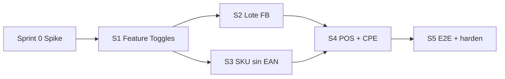

# Planning y Roadmap — RCP Subastas POS

**Rama:** `feature/rcp-subastas-pos`  
**Documento origen:** especificaciones técnicas y prompts Cursor AI  
**Estado:** Aprobado (D1–D6 + roadmap) — Sprint 5 listo para PR a `main`

---

## 1. Principios de ejecución

1. Trabajar solo en `feature/rcp-subastas-pos`; commits por sprint.
2. Reutilizar el monolito existente (no duplicar proyectos ni stacks fiscales).
3. Aislar Trunqi: defaults = comportamiento actual; features RCP solo con toggle ON.
4. Gate estricto entre sprints: no avanzar sin criterios de validación OK.
5. POS orquesta `PagosService` + `PedidosDigitalesService` + `ServicioFiscal` (D4).
6. Lotes FB extienden `SubastasTcg*` vía `POST /api/subastas-tcg/lote-masivo` (D2).

---


## 2. Decisiones aprobadas (D1–D6)


| ID     | Tema                    | Decisión                                                                                                                                      |
| ------ | ----------------------- | --------------------------------------------------------------------------------------------------------------------------------------------- |
| **D1** | Persistencia de toggles | Columnas / settings en `Empresa` (JSON u owned/columns) + seed Trunqi/RCP; no solo claims JWT estáticos.                                      |
| **D2** | Prefijo API lote        | Extender `POST /api/subastas-tcg/lote-masivo` (no `/api/subastas/...`).                                                                       |
| **D3** | SKU                     | Usar/enriquecer `Producto.CodigoSku` con generador `RCP-{CAT}-{SEQ}`; campos extra (`EsColeccionableSinCodigo`, `UbicacionTienda`) si faltan. |
| **D4** | POS cobrar+emitir       | Orquestar flujos existentes; facade `POST /api/pos/cobrar-y-emitir` para UX.                                                                  |
| **D5** | Meta Graph API          | Sprint 2 = copiar texto + export JSON; Graph API fase 2 opcional.                                                                             |
| **D6** | Seed tenant RCP         | Crear/activar empresa RCP en seed local con toggles ON (sin tocar prod Trunqi).                                                               |


---


## 3. Arquitectura actual (punto de partida)

```
SistColeccionables/
├── backend/CapitalPos.Tcg.Api/     # Controllers → Application → Domain → Infrastructure
├── backend/CapitalPos.Tcg.Api.Tests/
└── frontend/src/app/
    ├── core/                      # auth, http (tenant interceptor), layout
    ├── layout/                    # navigation, sidebar, shell
    └── features/                  # pedidos-digitales, subastas-tcg, pagos, caja, ecosistema…
```

**Flujo comercial existente**

```
SubastaTcg --adjudicar--> PedidoDigital --pago--> Pagado
PedidoDigital --comprobante-consolidado | convertir-venta--> Venta --> ServicioFiscal --> CpeApiClient
```

**Sin módulo RCP/POS dedicado aún.** Feature toggles no existían antes del Sprint 1.

### Defaults de toggles por tenant


| Toggle                    | Trunqi | RCP Subastas |
| ------------------------- | ------ | ------------ |
| `PermitirSinglesTcg`      | true   | false        |
| `PermitirWooCommerceSync` | true   | false        |
| `PermitirPosMostrador`    | false  | true         |
| `PermitirSubastasLoteFB`  | false  | true         |
| `PermitirCromosSinCodigo` | false  | true         |


> Subastas TCG operativas de Trunqi siguen visibles; el **lote FB masivo** queda detrás de `PermitirSubastasLoteFB`.

---


## 4. Vista general de sprints




S2 y S3 pueden ir en paralelo tras S1; S4 depende de ambos.

---


## 5. Desglose por sprint


### Sprint 0 — Spike de alineación

**Objetivo:** Congelar contratos y mapa de reuso.


| Tarea                                      | Criterio                         |
| ------------------------------------------ | -------------------------------- |
| Inventario adjudicar → pedido → pago → CPE | Mapa documentado                 |
| Defaults Trunqi                            | Menús/rutas que no deben cambiar |
| Seed plan RCP vs Trunqi                    | IDs/nombres acordados            |


**Gate → S1:** D1–D6 confirmadas (aprobadas).

---


### Sprint 1 — Multi-tenant Feature Toggles

**Objetivo:** Activar/ocultar módulos por empresa sin romper Trunqi.

#### Backend (archivos)


| Área                                             | Cambio                                 |
| ------------------------------------------------ | -------------------------------------- |
| `Domain/Entities/Empresa.cs` + `TenantSettings`  | Persistencia toggles (D1)              |
| Migration EF                                     | Columnas + defaults Trunqi             |
| `DevelopmentDataSeeder`                          | Seed toggles Trunqi + empresa RCP (D6) |
| `RequiresFeatureAttribute`                       | Protege endpoints por feature          |
| `AuthController` / `LoginResponse`               | Retorna settings al frontend           |
| Controllers existentes (Woo, Singles, stubs POS) | Atributo donde aplique                 |


#### Frontend (archivos)


| Área                      | Cambio                       |
| ------------------------- | ---------------------------- |
| `TenantService`           | Estado de toggles post-login |
| `FeatureToggleGuard`      | Rutas en `app.routes.ts`     |
| Directiva `*hasFeature`   | UI condicional               |
| `navigation.ts` + sidebar | Filtrar ítems por feature    |
| `AuthSessionService`      | Persistir settings en sesión |


#### Criterios de validación (gate S1 → S2/S3)

- [x] Login Trunqi: menú y rutas equivalentes (sin POS; Woo/Singles visibles).
- [x] Login RCP: ve POS (placeholder ok); no ve Woo/Singles según flags.
- [x] API con flag OFF → 403 (`TenantFeaturesE2ETests`).
- [x] Migration `AddEmpresaTenantSettings` + seed RCP (`admin@rcp.local`).
- [x] Build BE OK; FE `ng build --configuration=development` OK.

---


### Sprint 2 — Creador de lotes masivo + texto Facebook

**Objetivo:** Hasta 50 fotos, matriz editable, texto listo para copiar (D5).


| Backend                                             | Frontend                               |
| --------------------------------------------------- | -------------------------------------- |
| `POST /api/subastas-tcg/lote-masivo` + feature flag | `CargaLoteSubastaComponent`            |
| DTOs + texto FB Carabaya #1150                      | Drag-drop, matriz, copiar, export JSON |
| Tests lote N ítems                                  | Nav solo con `PermitirSubastasLoteFB`  |


**Gate → S4:**

- [x] Endpoint `POST /api/subastas-tcg/lote-masivo` + feature flag
- [x] Texto FB Carabaya #1150 + correlativo artículo
- [x] UI `/app/subastas/carga-lote` (drag-drop, matriz, copiar, export JSON)
- [x] Trunqi sin acceso (403) — `LoteMasivoSubastaE2ETests`
- [x] Tarjetas Trello S2 → Realizado

---


### Sprint 3 — Productos sin EAN & SKU interno

**Objetivo:** Inventario cromos/álbumes/sobres (D3).


| Backend                                 | Frontend                            |
| --------------------------------------- | ----------------------------------- |
| Campos producto + `SkuGeneratorService` | Checkbox sin código; SKU readonly   |
| Feature `PermitirCromosSinCodigo`       | Impresión térmica 50×25 (JsBarcode) |


**Gate → S4:**

- [x] Campos `EsColeccionableSinCodigo`, `SkuInterno`, `UbicacionTienda` + migration
- [x] `SkuGeneratorService` formato `RCP-{CAT}-{SEQ}` + feature `PermitirCromosSinCodigo`
- [x] FE checkbox sin EAN, SKU readonly, impresión térmica 50×25 (JsBarcode)
- [x] Trunqi sin flujo cromos — `SkuInternoProductoE2ETests`

---


### Sprint 4 — POS mostrador + cobrar y emitir SUNAT

**Objetivo:** Buscar cliente FB, carrito consolidado, pago + CPE (D4).


| Backend                                    | Frontend                                 |
| ------------------------------------------ | ---------------------------------------- |
| `GET /api/pos/pedidos-pendientes`          | `features/pos/` checkout                 |
| `POST /api/pos/cobrar-y-emitir` (orquesta) | Buscador, carrito, medios pago, tipo CPE |
| Feature `PermitirPosMostrador`             | Ruta `/app/pos` + guard                  |


**Gate → S5:**

- [x] `GET /api/pos/pedidos-pendientes` (q nombre FB/DNI) + feature flag
- [x] `POST /api/pos/cobrar-y-emitir` orquesta caja → Pagos → Pagado → `IServicioFiscal`
- [x] UI `/app/pos`: grilla productos, pedidos FB pendientes, panel cobro/CPE
- [x] Trunqi sin POS — `PosCobrarEmitirE2ETests`

---


### Sprint 5 — E2E Paola + hardening pre-merge


| Prueba             | Resultado esperado                              |
| ------------------ | ----------------------------------------------- |
| Aislamiento Trunqi | Sin cambios visuales/funcionales                |
| E2E Paola          | 10 sobres lote → texto FB → POS cobra → CDR/PDF |
| Build              | Backend + frontend + tests críticos verdes      |
| Seed docs          | Cómo activar tenant RCP en local                |


**Gate → merge:**

- [x] `PaolaFlujoE2ETests` — lote 10 → texto FB → adjudicar → POS → CPE PDF/XML
- [x] Suite crítica: Tenant / Lote / SKU / POS / Paola
- [x] Trunqi 403 en POS, lote-masivo y cromos (`PaolaFlujoE2ETests` + `TenantFeaturesE2ETests`)
- [x] Docs seed: `docs/SEED_TENANT_RCP_LOCAL.md`
- [x] Trello S3/S4/S5 → ✅ Realizado


---


## 6. Commits sugeridos

1. `feat(tenant): feature toggles por empresa + guards UI`
2. `feat(subastas): carga masiva lote FB y texto publicable`
3. `feat(productos): SKU interno y productos sin EAN`
4. `feat(pos): POS mostrador cobrar-y-emitir CPE`
5. `test(rcp): E2E lote + POS + aislamiento Trunqi`

---


## 7. Criterio global antes de merge a `main`

1. Trunqi: regresión menú + 1 flujo pedido/pago.
2. RCP: E2E §7 de la especificación.
3. Flags OFF = endpoints nuevos inaccesibles.
4. Rama compila; tests de tenant/POS/lote verdes.

---


## 8. Riesgos


| Riesgo                                 | Mitigación                          |
| -------------------------------------- | ----------------------------------- |
| Spec nombra APIs nuevas que ya existen | Facade POS; no segundo stack fiscal |
| Migration afecta Trunqi                | Defaults = comportamiento actual    |
| CPE Production depende de SOL/cert     | Beta primero; Production opcional   |
| Subastas “TCG” vs coleccionables       | Reusar entidad; copy/UI por toggle  |


---


## 9. Referencias

- Spec: `especificaciones_tecnicas_y_prompts_cursor_ai.md` (descargas del cliente)
- Trello: workspace `Proyecto-SistColeccionables` — ver `docs/trello/TRELLO_CARDS_RCP_SUBASTAS.json` (import si MCP no autenticado)

